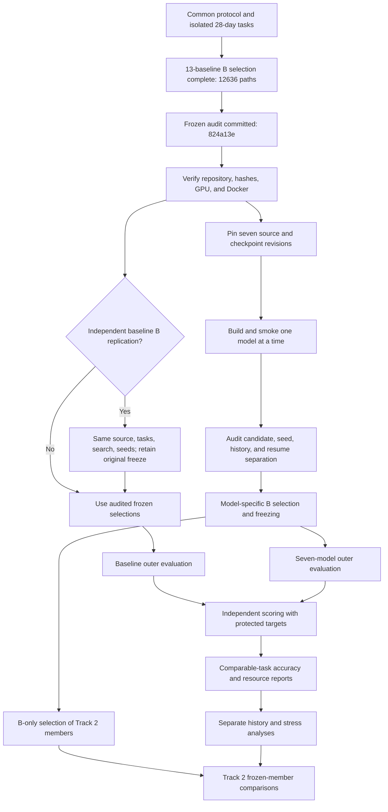

# GPU server: sequential seven-model execution checklist

**Archival checklist, state checked on 2026-09-28.** Commands assume a Linux server and the research repository root. This is an English translation and clarification of the historical execution plan, not a current completion certificate. Later audited evidence is indexed in [paper/](../../paper/README.md).

Run one model at a time: smoke first, register B01–B12 search/freezing, and only then perform the outer O01–O33 evaluation. Save commands, outputs, elapsed time, and failure reasons. Smoke results are not paper rankings. Open this file through the server's existing authorized SSH workflow after cloning or `git pull --ff-only origin main`.

## Historical status and workflow

| Work item | Status recorded on 2026-09-28 | Evidence or next action |
|---|---|---|
| Shared protocol and A/B/O origins | Complete | `shared/configs/protocol.yaml` |
| Isolated input and target artifacts | Generated | Shared inputs, targets, and task manifest |
| 13-baseline B validation | Complete and frozen | 33 candidates, 12,636/12,636 paths, zero terminal failures; baseline audit |
| Frozen audit pushed to GitHub | Complete | Commit `824a13e`; verify ancestry |
| Baseline outer evaluation | No output in the inspected local snapshot | Check the machine on which it actually ran |
| Seven adapters/CUDA containers | Implemented, GPU acceptance pending | `implemented_pending_gpu_smoke` |
| Source/checkpoint SHA pinning | Pending | Registry contained `REQUIRED_BEFORE_RUN` |
| Seven-model B search/freezing | Pending implementation/execution | Smoke `runtime` defaults are not final settings |
| Seven-model outer/history/stress | Pending | Require model-specific B freezing |
| Planned 20-model comparison and Track 2 | Dependent on prior stages | Same tasks and B-only member selection |



An independent server rerun of baseline B uses the same code, tasks, search space, and seeds, and reports environment differences. It must not replace the original frozen choice based on which repeat looks better.

## 1. Server and repository

- [ ] Record `date -Is`, `uname -a`, `nvidia-smi`, `docker version`, `docker compose version`, `git --version`, and `python3 --version`. Verify Compose v2, NVIDIA Container Toolkit, and existing Docker access.
- [ ] Check container GPU access:

  ```bash
  nvidia-smi
  docker run --rm --gpus all nvidia/cuda:12.8.0-base-ubuntu22.04 nvidia-smi
  ```

  The historical TimesFM, Chronos-2, Moirai, Granite, and PatchTST images use CUDA 12.8; Lag-Llama and Informer use CUDA 12.1. Verify actual Dockerfiles and driver support. Record any approved compatibility change before rebuilding.

- [ ] Use authorized repository credentials. Do not write private keys or GitHub/Hugging Face tokens into Git or chat. Verify the existing SSH configuration where applicable.
- [ ] Clone and inspect:

  ```bash
  git clone git@github.com:yqdiao/macau-tourism-forecasting-protocol.git
  cd macau-tourism-forecasting-protocol
  git log -1 --format='%H %s'
  git status --short
  ```

- [ ] Check the historical freezing commit and artifacts:

  ```bash
  git merge-base --is-ancestor 824a13e HEAD
  grep -n 'frozen_after_B_group_tuning' track1/configs/frozen_baseline_configs.yaml
  test -f track1/audit/b_validation/README.md
  ```

  Resolve branch/version mismatches before using the historical baseline freeze for outer evaluation.

- [ ] Install pipeline dependencies and audit artifacts:

  ```bash
  python3 -m venv .venv
  source .venv/bin/activate
  python -m pip install -r shared/requirements.txt
  python track1/code/audit_protocol_artifacts.py
  ```

- [ ] Verify inputs and manifest hashes. Although the repository contains `shared/data/targets.parquet`, predictors mount only an origin input shard, never the entire `shared/data` directory. Targets are read at independent scoring time.

## 2. Upstream repositories and frozen versions

Dockerfiles obtain official source and check out the registered commit. Separate manual clones are normally unnecessary; debugging copies must use the same pinned version.

| Model ID | Source | Registered checkpoint/training | Dockerfile |
|---|---|---|---|
| `chronos_2` | https://github.com/amazon-science/chronos-forecasting | `amazon/chronos-2` | `track1/docker/chronos2.Dockerfile` |
| `timesfm_3` | https://github.com/google-research/timesfm | `google/timesfm-3.0-pytorch` | `track1/docker/timesfm3.Dockerfile` |
| `granite_patchtst_fm` | https://github.com/ibm-granite/granite-tsfm | `ibm-granite/granite-timeseries-patchtst-fm-r2` | `track1/docker/granite.Dockerfile` |
| `moirai` | https://github.com/SalesforceAIResearch/uni2ts | `Salesforce/moirai-2.0-R-small` | `track1/docker/moirai.Dockerfile` |
| `lag_llama` | https://github.com/time-series-foundation-models/lag-llama | `time-series-foundation-models/Lag-Llama` | `track1/docker/lag_llama.Dockerfile` |
| `patchtst` | https://github.com/yuqinie98/PatchTST | Train within each origin | `track1/docker/patchtst.Dockerfile` |
| `informer` | https://github.com/zhouhaoyi/Informer2020 | Train within each origin | `track1/docker/informer.Dockerfile` |

- [ ] Review source/weight licenses, access conditions, model cards, and possible pretraining overlap. These are registered project IDs, not a guarantee that an unpinned current upstream API will match.
- [ ] For a newly specified run, resolve versions once:

  ```bash
  python track1/scripts/pin_upstream_revisions.py
  git diff -- track1/configs/upstream_revisions.yaml
  ```

- [ ] Review all seven source revisions and five checkpoint revisions as complete 40-character SHAs. The script edits the registry and generates ignored `track1/.env.pinned`. Commit the approved registry and record the research commit. Do not repin in the middle of a frozen replication.
- [ ] Record source/checkpoint hashes, image digest, Python/PyTorch/CUDA versions, and actual loaded weight-file hashes. Cache weights outside Git.

## 3. Create origin shards and smoke one model

- [ ] Prepare shards in the protected environment:

  ```bash
  python track1/code/prepare_origin_shards.py \
    --inputs shared/data/task_inputs.parquet \
    --output shared/data/origin_shards
  ```

- [ ] Inspect `origin_shards_manifest.json`. Each shard contains only inputs and an origin manifest. The first historical smoke example uses `recovery_tuning/B01_2023-01-07`; use the generated manifest if the actual path differs.
- [ ] Select one model, origin, output, and cache:

  ```bash
  export MODEL=chronos_2
  export ORIGIN_SHARD_DIR="$(pwd)/shared/data/origin_shards/recovery_tuning/B01_2023-01-07"
  export MODEL_CACHE_DIR="$(pwd)/track1/model-cache"
  export FOUNDATION_OUTPUT_ROOT="$(pwd)/track1/results/foundation_smoke"
  export RUN_OUTPUT_SUBDIR="recovery_tuning/B01_2023-01-07"
  export HISTORY_LENGTHS=all
  test -f "$ORIGIN_SHARD_DIR/task_inputs.parquet"
  test -f "$ORIGIN_SHARD_DIR/origin_shard_manifest.json"
  ```

- [ ] Inspect service/mount configuration, then build and run the selected model:

  ```bash
  docker compose --env-file track1/.env.pinned \
    -f track1/compose/foundation-gpu.yaml config --services
  docker compose --env-file track1/.env.pinned \
    -f track1/compose/foundation-gpu.yaml build "$MODEL"
  docker compose --env-file track1/.env.pinned \
    -f track1/compose/foundation-gpu.yaml run --rm "$MODEL"
  ```

  Resolve legitimate model access/license requirements rather than silently substituting unregistered weights.

- [ ] Inspect `run_manifest.json`, `predictions.parquet`, and `timings.jsonl` under `track1/results/foundation_smoke/recovery_tuning/B01_2023-01-07/$MODEL/`. Require exactly 28 future dates per task; finite raw and clipped predictions; declared point source; effective context; `history_end ≤ origin_date`; `target_artifact_accessed=false`; and no target mount.
- [ ] Record loading, training/inference, RAM/VRAM, active setup time if measured, errors, and retries. Repeat the same input/seed once for reproducibility; disclose differences when upstream operations are nondeterministic.

Sequential smoke order:

1. `chronos_2`
2. `timesfm_3`
3. `granite_patchtst_fm`
4. `moirai`
5. `lag_llama`
6. `patchtst`
7. `informer`

The first five use frozen pretrained weights in this design. The last two train on pre-origin windows, with labels ending no later than the origin. Preserve a failed model's logs and pinned settings before repairing and rerunning it. `implemented_pending_gpu_smoke` becomes accepted only with actual evidence.

## 4. B-group validation and formal-run gates

- [ ] Register finite B01–B12 candidate settings, seeds, budget, retry policy, and selection metric. The historical `runtime` values in the registry were smoke defaults; the repository snapshot did not yet include complete seven-model candidate search/freezing. Do not silently treat defaults as the final paper selection.
- [ ] Audit candidate/seed/history-specific output and resume keys. The original launcher tests for an existing `run_manifest.json`, without distinguishing every setting. Until repaired, use separate roots for each setting.
- [ ] After addressing those issues, run one model's B/all configuration:

  ```bash
  python track1/scripts/run_foundation_origins.py "$MODEL" \
    --splits recovery_tuning \
    --history all \
    --output-root "$(pwd)/track1/results/foundation_B_${MODEL}"
  ```

- [ ] Merge only that model/split/history root. The historical merger recursively collects matching files, so mixing A/O or 180/365 outputs contaminates the intended collection:

  ```bash
  python track1/code/combine_foundation_outputs.py \
    --root "track1/results/foundation_B_${MODEL}" \
    --model "$MODEL" \
    --output "track1/results/combined/${MODEL}_B_all"
  ```

- [ ] Seal forecast hashes before independent scoring:

  ```bash
  python track1/code/evaluate_predictions.py \
    --predictions "track1/results/combined/${MODEL}_B_all/predictions.parquet" \
    --targets shared/data/targets.parquet \
    --output "track1/evaluation/${MODEL}_B_all"
  ```

- [ ] Calculate task MASE(7), then macro-average markets, folds, and declared seeds. Freeze according to registered rules, retaining the complete candidate table, failures, configuration hash, and timestamp. Hong Kong does not select Macau parameters.
- [ ] After each model's B freeze, run the common outer tasks, then separate history and stress analyses. Use distinct roots per split/history/configuration/seed. Outer targets do not retune parameters. Track 2 member selection also follows its registered B-only rule.

## 5. Model-level handover

- [ ] Commit small auditable records: versions, frozen configurations, task/data hashes, environments/image digests, candidate summaries, coverage/failures, accounting scope, and execution notes.
- [ ] Archive raw predictions, task metrics, logs, and checkpoints with hashes and authorized storage locations. Do not push weights, images, bulk shards, credentials, or tokens.
- [ ] Inspect the actual diff before committing. Comparable formal results require the same task set, 28-day horizon, and task-level scoring semantics.

See [FOUNDATION_MODELS_GPU.md](FOUNDATION_MODELS_GPU.md), [SERVER_MODEL_EXECUTION.md](SERVER_MODEL_EXECUTION.md), and the actual Compose definitions. Repair API/dependency issues under a recorded revision and repeat acceptance; never mark a failed run complete by bypassing its checks.
