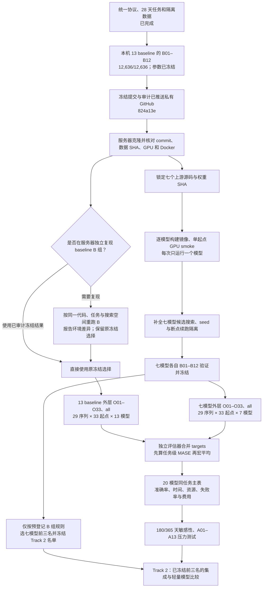

# GPU 服务器：七个时序模型逐个运行 TODO

本清单供连接 GPU 服务器的 Cursor/Codex 执行。所有命令默认在 **Linux 服务器** 的研究仓库根目录运行；一次只处理一个模型。先完成单模型 smoke，再建立七模型 B01–B12 搜索与冻结，最后运行 O01–O33 外层回测。每完成一项，保存命令、输出、耗时和失败原因，不要把 smoke 结果称为论文排名。

本文件随研究仓库保存。服务器克隆仓库（已有克隆则执行 `git pull --ff-only origin main`）后，用 Cursor Remote SSH 打开 `track1/docs/GPU服务器_七模型逐个运行TODO.md`，按清单逐项执行。

## 当前进度与完整流程

以下状态在 2026-09-28 从本机仓库核对。Mac 上的外层回测和未来 GPU 服务器的实际状态，需要在对应机器另行检查。

| 工作 | 当前状态 | 验收证据或下一动作 |
|---|---|---|
| 共用协议与 A/B/O 起点 | 已完成 | `shared/configs/protocol.yaml` 含 A01–A13、B01–B12、O01–O33 |
| 隔离输入与目标 | 已生成 | `shared/data/task_inputs.parquet`、`targets.parquet`、`task_manifest.json` |
| 13 个 baseline 的 B 组 | **已完成并冻结** | 33 个候选，12,636/12,636 路径，失败 0；`track1/audit/b_validation/` 和冻结配置 |
| 冻结结果推送 GitHub | 已完成 | 冻结配置与审计记录已由提交 `824a13e` 推送至私有仓库；服务器须核对该提交是当前 `HEAD` 的祖先 |
| baseline 外层 O01–O33 | 本机仓库尚无结果 | Mac 曾计划运行，需在 Mac 核验进程、覆盖率和 manifest |
| 七模型统一 adapter 与 CUDA 容器 | 已实现，未完成 GPU 验收 | 各模型均为 `implemented_pending_gpu_smoke` |
| 七模型源码与权重 SHA | 待锁定 | `upstream_revisions.yaml` 仍含 `REQUIRED_BEFORE_RUN` |
| 七模型 B 组候选搜索与冻结 | 待实现、待运行 | smoke 默认 `runtime` 不能当论文最终参数 |
| 七模型外层、敏感性与 A 组 | 待运行 | 七模型先通过各自 B 组冻结 |
| Track 1 的 20 模型比较与 Track 2 | 待前述结果完成 | 相同任务集合上比较，Track 2 前三名按预登记 B 组规则选择 |



**服务器上紧接着做什么：**克隆私有仓库，核对冻结提交、配置状态和数据哈希，再验证 GPU。随后可并行推进两条独立工作线：用冻结的 baseline 配置跑外层；逐个完成七模型的 GPU smoke 和 B 组冻结。若希望在服务器重新跑 13 个 baseline 的 B 组，把它定义为**独立复现实验**，使用相同的代码 commit、任务清单、搜索空间和 seed，比较结果差异；不得根据第二次验证结果事后更改已用于主研究的冻结规则或在两个结果中挑较好者。

## 1. 服务器和研究仓库

- [ ] 在服务器记录 `date -Is`、`uname -a`、`nvidia-smi`、`docker version`、`docker compose version`、`git --version`、`python3 --version`。确认 Docker Compose v2、NVIDIA Container Toolkit 可用，且当前用户有 Docker 权限。
- [ ] 验证容器可见 GPU：

  ```bash
  nvidia-smi
  docker run --rm --gpus all nvidia/cuda:12.8.0-base-ubuntu22.04 nvidia-smi
  ```

  当前仓库的 TimesFM、Chronos-2、Moirai、Granite、PatchTST 镜像基于 CUDA 12.8；Lag-Llama 和 Informer 基于 CUDA 12.1。若驱动无法支持相应镜像，先调整并记录兼容方案，再构建模型。

- [ ] 在服务器配置对 **私有** GitHub 仓库的 SSH 只读或读写访问；不要把私钥、GitHub token、Hugging Face token 写进仓库或聊天记录。验证 `ssh -T git@github.com`。
- [ ] 克隆研究仓库，并用 Cursor 的 Remote SSH 打开该目录：

  ```bash
  git clone git@github.com:yqdiao/macau-tourism-forecasting-protocol.git
  cd macau-tourism-forecasting-protocol
  git log -1 --format='%H %s'
  git status --short
  ```

- [ ] **核对远端版本。** 冻结提交 `824a13e` 已推送。确认当前检出的提交包含它，并检查冻结配置和审计记录：

  ```bash
  git merge-base --is-ancestor 824a13e HEAD
  grep -n 'frozen_after_B_group_tuning' track1/configs/frozen_baseline_configs.yaml
  test -f track1/audit/b_validation/README.md
  ```

  任一检查失败时，先核对分支和远端更新；不得用未冻结配置运行 baseline 外层回测。
- [ ] 安装宿主机数据管道依赖，并执行已有的协议审计：

  ```bash
  python3 -m venv .venv
  source .venv/bin/activate
  python -m pip install -r shared/requirements.txt
  python track1/code/audit_protocol_artifacts.py
  ```

- [ ] 确认 `shared/data/task_inputs.parquet`、`shared/data/task_manifest.json` 可读且 SHA256 与 manifest 一致。仓库目前也包含 `shared/data/targets.parquet`；**预测容器只挂载一个起点的输入分片**，不得挂载整个 `shared/data`。独立评估阶段才读取 targets。

## 2. 七个上游仓库与版本冻结

研究仓库的七个 Dockerfile 会在镜像构建时自动克隆下表中的上游仓库，并 checkout 到登记的完整 commit；通常无需手工再克隆七份源码。若调试上游 API，可在服务器 `scratch` 目录按同一 commit 单独克隆，不能以浮动 `main` 运行论文实验。

| 研究模型 ID | 上游源码仓库 | 权重或训练方式 | Dockerfile |
|---|---|---|---|
| `chronos_2` | https://github.com/amazon-science/chronos-forecasting | `amazon/chronos-2` | `track1/docker/chronos2.Dockerfile` |
| `timesfm_3` | https://github.com/google-research/timesfm | `google/timesfm-3.0-pytorch` | `track1/docker/timesfm3.Dockerfile` |
| `granite_patchtst_fm` | https://github.com/ibm-granite/granite-tsfm | `ibm-granite/granite-timeseries-patchtst-fm-r2` | `track1/docker/granite.Dockerfile` |
| `moirai` | https://github.com/SalesforceAIResearch/uni2ts | `Salesforce/moirai-2.0-R-small` | `track1/docker/moirai.Dockerfile` |
| `lag_llama` | https://github.com/time-series-foundation-models/lag-llama | `time-series-foundation-models/Lag-Llama` | `track1/docker/lag_llama.Dockerfile` |
| `patchtst` | https://github.com/yuqinie98/PatchTST | 按起点训练，无预训练权重 | `track1/docker/patchtst.Dockerfile` |
| `informer` | https://github.com/zhouhaoyi/Informer2020 | 按起点训练，无预训练权重 | `track1/docker/informer.Dockerfile` |

- [ ] 审核每个模型的源码和权重许可证、访问条件、模型卡、预训练数据重叠风险。上表是**当前项目登记值**；以锁定 revision 的实际文件和模型卡为准。
- [ ] 在联网环境解析七个源码 HEAD 和五个 Hugging Face 权重 revision：

  ```bash
  python track1/scripts/pin_upstream_revisions.py
  git diff -- track1/configs/upstream_revisions.yaml
  ```

- [ ] 人工审核解析结果，确认七个 `source_revision` 和五个 `checkpoint_revision` 都是完整 40 位 SHA。`pin_upstream_revisions.py` 会修改登记表，并生成被忽略的 `track1/.env.pinned`；正式运行前提交经审核的登记表，记录研究仓库 commit。不要反复运行 pin 脚本导致中途切换上游版本。
- [ ] 记录模型源码 commit、权重 revision、Docker 镜像 digest、Python/PyTorch/CUDA 版本和实际加载的模型文件 SHA256。权重下载到服务器缓存；不提交权重、镜像或密钥。

## 3. 建立单起点输入，只运行一个模型

- [ ] 在受保护的数据准备环境生成分片：

  ```bash
  python track1/code/prepare_origin_shards.py \
    --inputs shared/data/task_inputs.parquet \
    --output shared/data/origin_shards
  ```

- [ ] 检查 `shared/data/origin_shards/origin_shards_manifest.json`；每个分片应只有 `task_inputs.parquet` 和 `origin_shard_manifest.json`。选择 B01 分片 `shared/data/origin_shards/recovery_tuning/B01_2023-01-07` 作第一次 smoke；若实际目录日期有变化，以生成的 manifest 为准。
- [ ] 设置本轮的起点、输出与缓存。下面以 `chronos_2` 为例；替换模型 ID 即可**一次运行一个模型**：

  ```bash
  export MODEL=chronos_2
  export ORIGIN_SHARD_DIR="$(pwd)/shared/data/origin_shards/recovery_tuning/B01_2023-01-07"
  export MODEL_CACHE_DIR="$(pwd)/track1/model-cache"
  export FOUNDATION_OUTPUT_ROOT="$(pwd)/track1/results/foundation_smoke"
  export RUN_OUTPUT_SUBDIR="recovery_tuning/B01_2023-01-07"
  export HISTORY_LENGTHS=all
  test -f "$ORIGIN_SHARD_DIR/task_inputs.parquet"
  test -f "$ORIGIN_SHARD_DIR/origin_shard_manifest.json"
  ```

- [ ] 构建**所选一个模型**的镜像，并确认容器配置只挂载所选分片、配置、缓存和输出：

  ```bash
  docker compose --env-file track1/.env.pinned \
    -f track1/compose/foundation-gpu.yaml config --services
  docker compose --env-file track1/.env.pinned \
    -f track1/compose/foundation-gpu.yaml build "$MODEL"
  docker compose --env-file track1/.env.pinned \
    -f track1/compose/foundation-gpu.yaml run --rm "$MODEL"
  ```

  镜像构建会从上表的对应上游仓库克隆源码并校验 commit。模型第一次运行可能下载权重；遇到访问限制或许可证确认，应停止该模型并处理授权，不要临时改用未登记的权重。

- [ ] 查看 `track1/results/foundation_smoke/recovery_tuning/B01_2023-01-07/$MODEL/` 下的 `run_manifest.json`、`predictions.parquet`、`timings.jsonl`。通过条件：每个任务正好 28 个未来日期；`prediction_raw` 和非负裁剪后的 `prediction` 均保存且有限；`point_source` 说明 q=0.5 或样本中位数；`effective_context_days` 已保存；`history_end ≤ origin_date`；manifest 中 `target_artifact_accessed=false`；容器挂载不含 `targets.parquet`。
- [ ] 记录加载时间、训练/推理时间、峰值 RAM/显存、首次成功预测的研究者工时、错误及重试次数。对同一输入和 seed 再运行一次，核对预测是否可复现；若上游存在非确定性，记录差异及设置。

按以下顺序**逐个**重复本节；某个模型失败时保存日志和固定版本，修好后只重跑该模型：

1. `chronos_2`
2. `timesfm_3`
3. `granite_patchtst_fm`
4. `moirai`
5. `lag_llama`
6. `patchtst`
7. `informer`

其中前五个使用固定预训练权重；`patchtst` 和 `informer` 在每个预测起点以内的历史窗口上训练，训练标签结束日期必须不晚于起点。当前七个 adapter 的状态是 `implemented_pending_gpu_smoke`，实际 GPU 运行尚未验收。

## 4. 单模型 B 组验证和正式运行门槛

- [ ] 先为所选模型登记有限的 B01–B12 候选配置、seed、资源预算、失败重试规则和优选指标。现有 `track1/configs/upstream_revisions.yaml` 的 `runtime` 字段只是 smoke 默认设置；仓库目前**没有七模型的候选搜索与冻结程序**。请 Cursor 先实现并审计，不能直接把默认值当成论文最终配置。
- [ ] 先确认逐起点启动器能正确处理该模型的候选 ID、seed 和历史设置。当前 `run_foundation_origins.py` 只按 `run_manifest.json` 是否存在判断完成，完成标记没有区分候选和 `all/180/365`；因此在修复之前，不要在同一输出目录切换候选、seed 或历史设置。
- [ ] 完成以上修复后，只运行**一个模型**的 B 组 `all`。现有启动器的基本调用是：

  ```bash
  python track1/scripts/run_foundation_origins.py "$MODEL" \
    --splits recovery_tuning \
    --history all \
    --output-root "$(pwd)/track1/results/foundation_B_${MODEL}"
  ```

- [ ] 合并时使用这个模型专属的 `--root`。现有合并器会递归收集 root 下该模型的全部结果，所以 root 不能混入 A 组、外层或 180/365 天输出：

  ```bash
  python track1/code/combine_foundation_outputs.py \
    --root "track1/results/foundation_B_${MODEL}" \
    --model "$MODEL" \
    --output "track1/results/combined/${MODEL}_B_all"
  ```

- [ ] 预测结束并封存 SHA256 后，**只在独立评估环境**读取 targets：

  ```bash
  python track1/code/evaluate_predictions.py \
    --predictions "track1/results/combined/${MODEL}_B_all/predictions.parquet" \
    --targets shared/data/targets.parquet \
    --output "track1/evaluation/${MODEL}_B_all"
  ```

- [ ] 在 B 组比较每条 28 天路径的 MASE(7) 后按市场、折次和 seed 宏平均；按预先登记的规则选定配置，保存候选全表、失败记录、配置 SHA256 和冻结时间。香港不能参与澳门 B 组参数选择。
- [ ] 七个模型各自完成 B 组冻结后，才对同一批 O01–O33 外层任务运行 `all`；再运行 180/365 天敏感性和 A01–A13 疫情压力测试。每个 split、历史设置、候选/冻结配置使用独立输出 root；外层目标不得用于重新调参。Track 2 的前三名也按事先登记的 B 组规则确定。

## 5. 每个模型结束时交付给研究仓库

- [ ] 提交小型、可审计制品：版本登记、冻结配置、任务清单与数据 SHA256、环境和镜像 digest、候选汇总、覆盖率、失败率、费用口径、运行说明。
- [ ] 归档服务器上的原始预测、逐任务指标、日志与 checkpoint，并保存其 SHA256 和存放位置；不要把大模型权重、Docker 镜像、大量分片、私钥或 token 推入 Git。
- [ ] 在 Cursor 中核对 `git diff`，只提交预期文件。正式比较前确认七模型与 13 个 baseline 使用同一 O01–O33 任务集合、同一 28 天 horizon 和一致的任务级评价口径。

相关实现细节见 `track1/docs/FOUNDATION_MODELS_GPU.md`、`track1/docs/SERVER_MODEL_EXECUTION.md` 和 `track1/compose/foundation-gpu.yaml`。本清单记录当前仓库的可执行入口；在 GPU 上发现 API/依赖问题时，修复 adapter 或锁定版本后重新验收，不得绕过失败直接标记完成。
